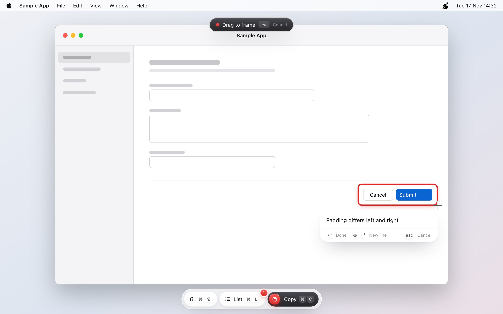

<p align="center">
  
</p>

<p align="center"><strong>Mark it up. Hand it right back.</strong></p>

<p align="center">
  Circle what's off on your screen, add a note, and paste it all to your AI agent in one go.<br>
  A small menu bar app for macOS.
</p>

<p align="center">
  <a href="https://akapen.yuto343.net">Website</a> ·
  <a href="https://github.com/yuto343/akapen/releases/latest">Download</a> ·
  <a href="#日本語">日本語</a>
</p>



## What it does

1. Press the hotkey (`⌘⇧6` by default). The cursor turns into a crosshair.
2. Drag a frame around anything on the screen. akapen captures the area as you see it and draws the red frame into the image.
3. Type a comment and press `Return`. Frame the next spot right away, as many as you like.
4. Press `⌘C` to copy the prompt, then paste it into Claude Code, Codex CLI, Cursor, or any AI chat.

The copied prompt looks like this:

```
I annotated the screen. Please address the comments below.
Open every image and check the area marked with the red frame before you start.

/Users/you/Library/Caches/akapen/20261117-1432/01.png
Padding differs left and right

/Users/you/Library/Caches/akapen/20261117-1432/02.png
Change this label to "Save"
```

Images are saved under `~/Library/Caches/akapen/` so the agent can open them later, and old ones are removed after a set number of days (7 by default).

### Shortcuts while framing

| Key | Action |
| --- | --- |
| `⌘⇧6` | Show / hide the toolbar (your notes are kept) |
| `⌘C` | Copy the prompt and finish |
| `⌘L` | Open / close the list to review, edit, or delete notes |
| `⌘⌫` | Delete all notes (asks first) |
| `Esc` | Go back one step |

The hotkey, the key to confirm a comment, the opening text of the prompt, the language (English / Japanese), and how long images are kept can all be changed in Settings.

## Install

Requires macOS 15 or later (Apple silicon / Intel).

**Homebrew**

```sh
brew install --cask yuto343/tap/akapen
```

**Download**

Get `akapen.zip` from the [latest release](https://github.com/yuto343/akapen/releases/latest), unzip it, and move `akapen.app` to `/Applications`.

On first launch, akapen asks you to pick a hotkey and to allow Screen Recording. It stays in the menu bar and updates itself (Sparkle).

## Development

The repository holds the Mac app (`apps/mac`, Swift 6, no dependencies except Sparkle) and the website (`apps/site`, SvelteKit).

```sh
make build   # build the app
make run     # build and launch
make test    # unit and integration tests (swift test)
make e2e     # UI tests (XCUITest; takes over your mouse and keyboard)

pnpm install
pnpm dev:site   # website at http://127.0.0.1:5280
```

Building the app needs Xcode and [XcodeGen](https://github.com/yonaskolb/XcodeGen). Start with [`apps/mac/DESIGN.md`](apps/mac/DESIGN.md) (what it does) and [`apps/mac/ARCHITECTURE.md`](apps/mac/ARCHITECTURE.md) (how it is built). Both are written in Japanese.

## Support

If akapen saves you time, you can support it on [GitHub Sponsors](https://github.com/sponsors/yuto343) or [Ko-fi](https://ko-fi.com/yuto343).

## License

[MIT](LICENSE)

## 日本語

akapen は、画面の気になるところを赤枠で囲んでひと言コメントを付け、まとめて AI エージェントに貼り付けられる Mac のメニューバーアプリです。

- ホットキー（既定 `⌘⇧6`）→ ドラッグで囲む → コメントを書いて `Return` → 何か所でも続けて囲める → `⌘C` でプロンプトをコピーして、Claude Code や Codex CLI、Cursor などに貼り付ける。
- インストール: `brew install --cask yuto343/tap/akapen`、または [Releases](https://github.com/yuto343/akapen/releases/latest) から `akapen.zip` を落とす。macOS 15 以降。
- 設定で表示とプロンプトの言語を日本語にできます。
- 詳しくは [Web サイト](https://akapen.yuto343.net/ja/) を見てください。
